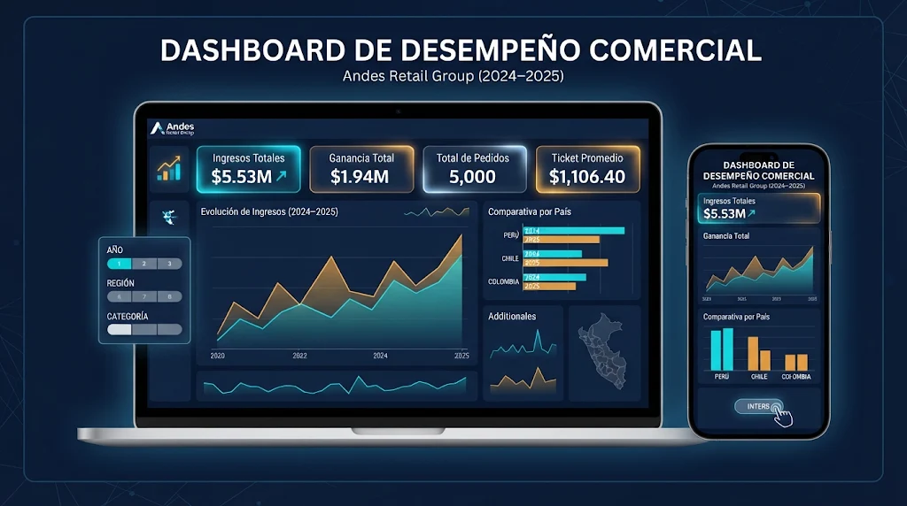

Tablero interactivo de inteligencia de negocios diseñado para monitorear el desempeño comercial, identificar tendencias clave y respaldar la toma de decisiones ejecutivas.

## 📂 Contenido del repositorio
* `images/` — Capturas de pantalla de las vistas principales del *dashboard*.
* `README.md` — Documentación del proyecto, métricas evaluadas y conclusiones.

## 📊 Métricas y vistas principales
* **Resumen ejecutivo:** Seguimiento general de ventas, ingresos, volumen de órdenes o transacciones y ticket promedio frente al periodo anterior.
* **Desempeño por segmento y geografía:** Comparativa entre regiones/países, categorías de producto o canales comerciales para detectar focos de crecimiento o rezagos.
* **Evolución temporal:** Tendencias mensuales o trimestrales y estacionalidad para anticipar picos o caídas.

## 💡 Conclusiones y recomendaciones clave
* **Concentración de resultados:** Identifica qué regiones, categorías o líneas de negocio impulsan la mayor parte de los ingresos y dónde existen oportunidades de mejora en conversión o ticket promedio.
* **Dinámica temporal:** Señala los periodos de mayor tracción y las variaciones interanuales o mensuales relevantes para planificar inventario, presupuesto y campañas.
* **Acción recomendada:** Priorizar recursos comerciales en los segmentos de mayor margen y retorno, y revisar los segmentos con caída sostenida para corregir fricciones operativas o de oferta.

* ## 🔗 Dashboard en Power BI
* [Descargar / ver archivo .pbix en Google Drive](https://drive.google.com/file/d/16Md50abSi5C4zGFBcj9k9CMkzwXk_OEp/view?usp=sharing)
